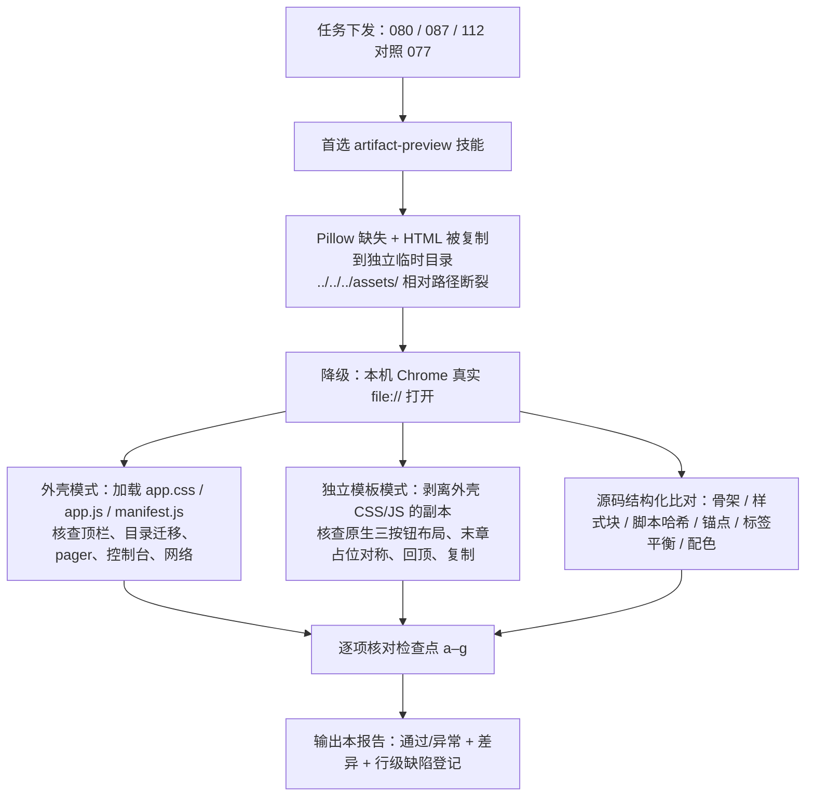

# 《Java 从 0 到精通》新补章节渲染抽查报告

> **抽查对象**：第 080、087、112 章（新补写）｜**对照基准（黄金样本）**：第 077 章
> **抽查日期**：2026-10-22｜**环境**：Windows NT · Chrome（本机已运行）· 静态本地 `file://` 渲染
> **抽查性质**：只检查、只报告，**未修改任何 `old-docs/` 源章节文件**。

---

## 目录

- [一、结论速览](#一结论速览)
- [二、抽查方法与环境](#二抽查方法与环境)
- [三、逐项检查结果（a–g）](#三逐项检查结果ag)
- [四、逐章结论卡](#四逐章结论卡)
- [五、与基准 077 的差异清单（任务必答）](#五与基准-077-的差异清单任务必答)
- [六、缺陷与观察登记（分级 · 行号 · 修复建议）](#六缺陷与观察登记分级--行号--修复建议)
- [附录 A · 结构指标留档](#附录-a--结构指标留档)
- [附录 B · Hero 头部文本留档](#附录-b--hero-头部文本留档)
- [附录 C · 截图索引](#附录-c--截图索引)
- [附录 D · 复现命令与既有校验脚本结果](#附录-d--复现命令与既有校验脚本结果)
- [附录 E · 环境限制说明](#附录-e--环境限制说明)

---

## 一、结论速览

### 1.1 总体判定

| 章节 | 文件 | 渲染结论 | 模板一致性（对照 077） | 阻塞性缺陷 |
|---|---|:---:|:---:|:---:|
| **077（基准）** | `90_第九篇_Spring核心/077_第77章_IoC概念.html` | ✅ 通过 | 基准 | — |
| **080** | `90_第九篇_Spring核心/080_第80章_Bean作用域与懒加载.html` | ✅ **通过** | ✅ 与基准一致（除内容与篇名外无模板差异） | 无 |
| **087** | `100_第十篇_SpringBoot与Web/087_第87章_SpringBoot入门与启动流程.html` | ✅ **通过** | ✅ 与基准一致（除内容与篇名外无模板差异） | 无 |
| **112** | `120_第十二篇_综合项目收官/112_第112章_进阶路线微服务与云原生.html` | ✅ **通过** | ✅ 与基准一致；仅按末章语义多一条"隐藏下一章"占位规则 | 无 |

**一句话结论**：三个新章页面均能正常渲染，无白屏、无样式大面积丢失、无横向溢出；骨架、配色、字体、间距、组件样式与基准 077 一致；**未发现新章引入的渲染级缺陷**。仅发现 1 处轻微措辞归属问题（080 第 126 行，非渲染缺陷），另有 4 项与基准同有的既有现象 / 全局待办，详见第六章。

### 1.2 抽查流程



### 1.3 检查点总表（a–g）

| # | 检查点 | 077 基准 | 080 | 087 | 112 |
|---|---|:---:|:---:|:---:|:---:|
| a | 正常渲染，无白屏、无样式大面积丢失 | ✅ | ✅ | ✅ | ✅ |
| b | Hero：breadcrumb / h1 / badge / meta / hero-desc 正常，篇定位正确 | ✅ | ✅ | ✅ | ✅ |
| c | doc-nav 三按钮布局正确；末章"下一章"隐藏占位、左右对称、无可见失效链接 | ✅ | ✅ | ✅ | ✅ |
| d | 目录两列显示、锚点可跳转 | ✅ | ✅ | ✅ | ✅ |
| e | 正文卡片：h2 编号、深色代码块 + 右上角语言标注、绿系 SVG、表格、习题三档、note | ✅ | ✅ | ✅ | ✅ |
| f | 与 077 基准布局 / 配色 / 字体 / 间距一致，无错位、溢出、横向滚动异常 | ✅ | ✅ | ✅ | ✅ |
| g | 底部 footer、回顶按钮、复制按钮脚本无报错 | ✅ | ✅ | ✅ | ✅ |

---

## 二、抽查方法与环境

### 2.1 渠道选择（按任务优先级执行）

1. **首选 `artifact-preview` 技能**：已读取 `…/.skills/artifact-preview/SKILL.md` 并对 4 个文件执行 `preview render`。该渠道不可用，原因有二：
   - 本机缺少 Pillow，截图切片失败（`No module named 'PIL'`，`pages` 为空，仅文本抽取成功）；
   - 技能把 HTML 复制到独立临时目录渲染，页面内 `../../../assets/app.css`、`app.js` 相对路径必然断裂，无法还原真实外壳效果。
2. **降级方案（实际采用）**：本机 Chrome 以真实 `file:///F:/…` 打开页面，共享资源 `old-docs/assets/app.css`、`app.js`、`manifest.js` 随相对路径正常加载。
3. **兜底方案（已并行执行）**：对 4 个文件做源码骨架与样式 / 脚本哈希比对，作为视觉结论的交叉证据。

### 2.2 两种渲染模式

| 模式 | 说明 | 用途 |
|---|---|---|
| **外壳模式** | 真实 `file://` 打开章节 HTML，`app.css` + `app.js` + `manifest.js` 全部加载，与读者在书架空境下看到的页面一致 | 核查顶栏、左侧目录迁移、底部 pager、控制台报错、网络请求、正文组件渲染 |
| **独立模板模式** | 生成剥离 `app.css` / `app.js` 的临时副本（不交付、不改动源文件），仅保留章节内联样式与内联脚本 | 核查章节原生 `doc-nav` 三按钮几何布局、112 末章隐藏占位对称性、回顶按钮、复制按钮注入、两列目录原生版式 |

### 2.3 实测环境指标

- 浏览器视口：563 × 683（自动化后端固定，CDP 改宽屏接口报 `session not found`，宽屏布局以源码媒体查询 + 独立模式注入 `columns:2` 截图佐证，见检查点 d）。
- 外壳模式实测：4 页 `document.documentElement.scrollWidth === clientWidth`，**无页面级横向溢出**；`console` 全部为空；HTTP ≥ 400 请求数为 0。
- 共享资源均存在且加载成功：`old-docs/assets/app.css`、`app.js`、`manifest.js`；外壳模式 body 背景为暖纸色 `rgb(244,239,228)`，证明 `app.css` 生效。

---

## 三、逐项检查结果（a–g）

### a) 页面能否正常渲染（无白屏、无样式大面积丢失）—— **4/4 通过**

| 章节 | 白屏 | 样式丢失 | body 背景（app.css 生效证据） | 控制台 | HTTP ≥ 400 | 横向溢出 |
|---|:---:|:---:|---|:---:|:---:|:---:|
| 077 | 无 | 无 | `rgb(244,239,228)` | `[]` | 0 | 否 |
| 080 | 无 | 无 | `rgb(244,239,228)` | `[]` | 0 | 否 |
| 087 | 无 | 无 | `rgb(244,239,228)` | `[]` | 0 | 否 |
| 112 | 无 | 无 | `rgb(244,239,228)` | `[]` | 0 | 否 |

证据截图：`screenshots/shell/077_1_hero.png`、`080_1_hero.png`、`087_1_hero.png`、`112_1_hero.png`。

### b) 头部 Hero：breadcrumb、h1、badge、meta、hero-desc —— **4/4 通过**

| 章节 | breadcrumb（篇定位） | h1 | badge | meta | hero-desc |
|---|---|---|:---:|---|---|
| 077 | 从 0 到精通 · 《Java 从 0 到精通》 · **第九篇 Spring 核心** | 第 77 章 IoC 概念：控制反转的来龙去脉 | 教科书 | 第 77 章 / 共 112 章 · 预计 40 分钟 · **第九篇开篇** | ✅ 正常 |
| 080 | 从 0 到精通 · 《Java 从 0 到精通》 · **第九篇 Spring 核心** | 第 80 章 Bean 作用域与懒加载 | 教科书 | 第 80 章 / 共 112 章 · 预计 40 分钟 · **第九篇续章** | ✅ 正常 |
| 087 | 从 0 到精通 · 《Java 从 0 到精通》 · **第十篇 SpringBoot 与 Web** | 第 87 章 SpringBoot 入门与启动流程 | 教科书 | 第 87 章 / 共 112 章 · 预计 40 分钟 · **第十篇开篇** | ✅ 正常 |
| 112 | 从 0 到精通 · 《Java 从 0 到精通》 · **第十二篇 综合项目收官** | 第 112 章 进阶路线：微服务与云原生 | 教科书 | 第 112 章 / 共 112 章 · 预计 40 分钟 · **全书收官** | ✅ 正常 |

- 三章篇定位文字与所属篇目录一致：080 属第九篇（续章）、087 属第十篇（开篇）、112 属第十二篇（全书收官），**无篇名错挂**。
- Hero 深绿渐变底、浅色标题、`教科书` 绿色胶囊徽章、meta 灰色辅助文字、hero-desc 正文颜色，与基准 077 视觉一致。
- 证据：`screenshots/shell/080_1_hero.png`、`087_1_hero.png`、`112_1_hero.png`；独立模式对照 `screenshots/standalone/sa_080_1_hero.png`、`sa_087_1_hero.png`、`sa_112_1_hero.png`。

### c) doc-nav 三按钮布局；112 末章隐藏占位 —— **4/4 通过**

**外壳模式**：`app.css` 第 325 行 `nav.doc-nav{display:none !important}` 统一隐藏章节原生导航条（基准与新章一致），外壳自身提供顶栏返回箭头与底部 pager 卡片。

**独立模板模式**（章节原生导航，剥离外壳后核查几何布局）：

| 章节 | 上一章 | 返回首页 | 下一章 | 几何位置（实测） | 对称性 |
|---|:---:|:---:|:---:|---|:---:|
| 077 | ✅ 可见 | ✅ 可见 | ✅ 可见 | 上一章 x=20 w=71；首页 x=232 w=85；下一章 x=457 w=71（right=528） | ✅ |
| 080 | ✅ 可见 | ✅ 可见 | ✅ 可见 | 与基准同位置、同尺寸 | ✅ |
| 087 | ✅ 可见 | ✅ 可见 | ✅ 可见 | 与基准同位置、同尺寸 | ✅ |
| 112 | ✅ 可见 | ✅ 可见 | ⛔ **隐藏占位** | 隐藏按钮保留原占位盒（x=457 w=71），与基准下一章槽位重合 | ✅ 左右对称 |

**112 末章隐藏实现核查**（符合任务要求：隐藏不可见、槽位对称保留、不可点击、无可见失效链接）：

- 样式规则：`112_…html` 第 **78** 行
  ```css
  .doc-nav-btn.hidden{visibility:hidden;pointer-events:none}
  ```
- 顶部导航：第 **93–96** 行；底部导航：第 **343–346** 行；隐藏按钮为
  ```html
  <a class="doc-nav-btn hidden" href="#">下一章 →</a>
  ```
- `visibility:hidden` **保留原占位盒**（槽位宽度不塌缩），`pointer-events:none` 阻断点击；DOM 中保留文字但页面不可见、不可点击，**未出现可见的失效链接**；左右两槽位与基准三按钮布局对称。
- 导航目标文件全部存在于磁盘（详见附录 D 既有校验脚本结果）：
  - 080：上一章 `079_第79章_依赖注入三种方式与选择.html`、下一章 `081_第81章_AOP概念与动态代理回顾.html`
  - 087：上一章 `../90_第九篇_Spring核心/086_第86章_自动装配原理前奏.html`、下一章 `088_第88章_配置体系与多环境.html`
  - 112：上一章 `111_第111章_面试知识体系梳理.html`；下一章为隐藏占位 `href="#"`
- 证据：`screenshots/standalone/sa_077_3_bottom.png`（基准三按钮）、`sa_112_3_bottom.png`（112 左 / 中可见、右槽位留空对称）、`sa_080_3_bottom.png`、`sa_087_3_bottom.png`。

### d) 目录（toc）两列显示、锚点可跳转 —— **4/4 通过**

| 章节 | 目录条目数 | 锚点 ↔ 小节 id 对应 | 独立模式两列版式 | 外壳模式 |
|---|:---:|---|:---:|---|
| 077 | 8 | 8/8 一一对应，无缺失目标 | ✅ 与基准一致 | 左侧栏迁移成功，单列（外壳设计如此） |
| 080 | 8 | 8/8 一一对应 | ✅ 与基准一致 | 左侧栏迁移成功，单列 |
| 087 | 9 | 9/9 一一对应 | ✅ 与基准一致 | 左侧栏迁移成功，单列 |
| 112 | 9 | 9/9 一一对应 | ✅ 与基准一致 | 左侧栏迁移成功，单列 |

- 章节内联样式（基准第 30、35、36 行，三新章逐行相同）：默认 `columns:2`；`@media(min-width:1024px)` 固定左侧栏目录；`@media(max-width:1023px)` 单列。
- 外壳模式 `app.css` 第 104 行强制 `#kb-toc .toc ol{grid-template-columns:1fr !important;display:block !important}`，左侧目录栏单列展示属外壳既定设计，**非样式缺陷**。
- 自动化视口 563px 触发窄屏单列；为核查宽屏两列版式，在独立模式副本上注入 `columns:2 !important` 后截图，四页两列网格、序号徽章、行距与基准一致。
- 锚点跳转：外壳 `app.js` 对目录链接做 `scrollIntoView` 平滑定位（共享脚本，基准同路径）；源码层已核对全部 `href="#secN"` 均有对应 `<section id="secN">`，无悬空锚点。
- 证据：`screenshots/toc-two-col/toc2_077.png`、`toc2_080.png`、`toc2_087.png`、`toc2_112.png`。

### e) 正文卡片组件渲染 —— **4/4 通过**

| 组件 | 077 | 080 | 087 | 112 | 核查结论 |
|---|:---:|:---:|:---:|:---:|---|
| `section.card` 小节卡片 | 8 | 8 | 9 | 9 | 卡片白底、圆角、阴影、间距与基准一致 |
| h2 编号徽章（`span.num`） | 77.1–77.5 | 80.1–80.5 | 87.1–87.6 | 112.1–112.6 | 编号前缀与章号一致，无错号 |
| `pre.code` 深色代码块 | 4 | 8 | 6 | 4 | 深底 `#15130D`、等宽字体、行高、内边距与基准一致；块内 `overflow-x:auto` 横向滚动属设计行为 |
| 右上角语言标注（`::before{content:attr(data-lang)}`） | java×4 | java×8 | xml / xml / java / java / properties / java | yaml / java / dockerfile / yaml | 全部代码块均带 `data-lang`，无遗漏；标注位置、颜色、字号与基准一致 |
| 复制按钮（内联脚本注入） | 4 | 8 | 6 | 4 | 数量与 `pre.code` 数量一一对应 |
| SVG 示意图 | 1 | 1 | 2 | 1 | 绿系主色 + 红 / 琥珀辅助色，全部落在基准调色板内（见 5.2） |
| 表格 | 2 | 4 | 5 | 6 | 固定布局、斑马纹、表头底色与基准一致；宽表块内横向滚动，不撑破页面 |
| 习题三档（`ex-box`：A 基础 / B 进阶 / C 挑战） | 3 | 3 | 3 | 3 | 三档标签、浅绿底色、缩进与基准一致 |
| `note` 注意框 | 1 | 1 | 1 | 1 | 琥珀左边框 + 浅底，与基准一致 |
| `warn-box` 警告框 | 0 | 2 | 2 | 1 | 渲染正常，配色沿用外壳覆盖规则 |
| `key-sentence` 关键句 | 1 | 2 | 2 | 3 | 绿色左边框，渲染正常 |
| `pit-sentence` 踩坑句 | 1 | 2 | 3 | 0 | 琥珀左边框，渲染正常（112 本章无踩坑句，属内容取舍，非缺失） |

证据：
- 代码块 + 语言标注：`screenshots/shell/077_2_code.png`、`080_2_code.png`、`087_2_table.png`（底部 xml 块）、`112_3_code.png`；独立模式 `sa_077_2_code.png`、`sa_080_2_code.png`、`sa_087_2_code.png`、`sa_112_2_code.png`。
- SVG 示意图：`screenshots/shell/080_3_diagram.png`（图 80-1 五种作用域边界）、`087_3_diagram1.png`（图 87-1 自动配置三段链路）、`087_4_diagram2.png`（图 87-2 启动时序）、`112_2_diagram.png`（图 112-1 三阶段进阶路线）。
- 习题三档 + 底部：`screenshots/shell/080_4_bottom.png`、`087_5_bottom.png`、`112_4_bottom.png`、`077_3_bottom.png`。

### f) 与 077 基准对比：布局、配色、字体、间距 —— **4/4 一致**

- **样式块哈希**（EOL 归一化后 SHA-256 前 16 位）：

  | 章节 | 内联 `<style>` 哈希 | 内联 `<script>` 哈希 |
  |---|---|---|
  | 077 | `CD8D4394510A4A57` | `2550697EA6B7F4AF` |
  | 080 | `CD8D4394510A4A57` ✅ 相同 | `2550697EA6B7F4AF` ✅ 相同 |
  | 087 | `CD8D4394510A4A57` ✅ 相同 | `2550697EA6B7F4AF` ✅ 相同 |
  | 112 | `20DE3E116DFED461`（仅多 1 条规则，见下） | `2550697EA6B7F4AF` ✅ 相同 |

- 077 ↔ 112 样式块逐行 `Compare-Object` 差异**仅一行**（112 新增，基准无删除行）：
  ```css
  .doc-nav-btn.hidden{visibility:hidden;pointer-events:none}
  ```
- 字体栈、字号、行高、卡片内边距、章节间距、Hero 尺寸、代码块尺寸、表格字号等均由同一份内联样式决定，实测无错位、无溢出；`body{overflow-x:hidden}`（内联样式第 12 行）保证页面级不出现横向滚动条。
- 宽表 / 长代码块在块内横向滚动（`pre.code` 第 50 行 `overflow-x:auto`；表格 `table-layout:fixed`），页面 `scrollWidth === clientWidth`，**正文宽度内无横向滚动异常**。
- 截图并排对照：`screenshots/standalone/` 下 `sa_077_*` 与 `sa_080_*`、`sa_087_*`、`sa_112_*` 同位置截图，视觉风格一致。

### g) 底部 footer、回顶按钮、复制按钮脚本 —— **4/4 通过**

| 检查项 | 077 | 080 | 087 | 112 | 说明 |
|---|:---:|:---:|:---:|:---:|---|
| footer 文案 | ✅ 第 77 章 IoC 概念 | ✅ 第 80 章 Bean 作用域与懒加载 | ✅ 第 87 章 SpringBoot 入门与启动流程 | ✅ 第 112 章 进阶路线：微服务与云原生 | 格式 `从 0 到精通 · 《Java 从 0 到精通》 · 第 N 章 标题`，与基准一致 |
| `#backTop` 元素存在 | ✅ | ✅ | ✅ | ✅ | 内联脚本第 290–296 行初始化 |
| 独立模式回顶功能 | ✅ 滚动 >480px 出现，点击平滑回顶 | ✅ | ✅ | ✅ | 与基准同脚本、同行为 |
| 复制按钮注入 | ✅ 4 个 | ✅ 8 个 | ✅ 6 个 | ✅ 4 个 | 数量与代码块一致 |
| 控制台报错 | `[]` | `[]` | `[]` | `[]` | 外壳模式实测无报错 |

> 外壳模式下回顶按钮不出现、复制按钮在自动化失焦环境下产生的未处理 Promise rejection，属既有现象，已在第六章 O2、O4 登记，基准 077 表现相同，**非新章回归**。

---

## 四、逐章结论卡

### 4.1 基准 · 077 第 77 章 IoC 概念：控制反转的来龙去脉

- **结论**：✅ 通过（基准样本）。
- 结构：8 小节 / 4 个代码块（java×4）/ 1 张示意图 / 2 张表格 / 目录 8 条 / 习题三档齐全。
- 外壳模式：顶栏分类芯片 + 位置编号 `78 / 80 篇` + 底部 pager 双卡片均正常（章节已收录于 `manifest.js`）。
- 证据：`screenshots/shell/077_1_hero.png`、`077_2_code.png`、`077_3_bottom.png`；`screenshots/standalone/sa_077_1_hero.png`、`sa_077_2_code.png`、`sa_077_3_bottom.png`；`screenshots/toc-two-col/toc2_077.png`。

### 4.2 080 第 80 章 Bean 作用域与懒加载 —— ✅ 通过

- **结构**：8 小节 / 8 个代码块（java×8）/ 1 张示意图（图 80-1）/ 4 张表格 / 目录 8 条 / 习题三档 / note×1、warn×2、key×2、pit×2。
- **Hero**：第九篇 Spring 核心 · 第九篇续章，篇定位正确。
- **导航**：上一章 079、下一章 081，目标文件均存在；三按钮布局与基准一致。
- **渲染观察**：代码块深色底 + `java` 标注 + 复制按钮齐全；作用域对比 SVG 中 singleton 绿底、prototype 红底（危险色）、request/session/application 绿底，配色在基准调色板内；习题 A/B/C 与下一章预告 note 正常。
- **遗留**：1 处措辞归属建议（D1，第 126 行，非渲染缺陷）。
- 证据：`screenshots/shell/080_1_hero.png`、`080_2_code.png`、`080_3_diagram.png`、`080_4_bottom.png`；`screenshots/standalone/sa_080_1_hero.png`、`sa_080_2_code.png`、`sa_080_3_bottom.png`；`screenshots/toc-two-col/toc2_080.png`。

### 4.3 087 第 87 章 SpringBoot 入门与启动流程 —— ✅ 通过

- **结构**：9 小节 / 6 个代码块（xml×2、java×3、properties×1）/ 2 张示意图（图 87-1、图 87-2）/ 5 张表格 / 目录 9 条 / 习题三档 / note×1、warn×2、key×2、pit×3。
- **Hero**：第十篇 SpringBoot 与 Web · 第十篇开篇，篇定位正确。
- **导航**：上一章跨篇目录 `../90_第九篇_Spring核心/086_…`，相对路径解析正确、目标存在；下一章 088 存在；三按钮布局与基准一致。
- **渲染观察**：SSM vs SpringBoot 对比表斑马纹正常；自动配置三段链路、`SpringApplication.run` 启动时序两张 SVG 均为绿系节点 + 箭头；`properties` / `xml` / `java` 语言标注齐全；习题 A/B/C 与下一章预告正常。
- 证据：`screenshots/shell/087_1_hero.png`、`087_2_table.png`、`087_3_diagram1.png`、`087_4_diagram2.png`、`087_5_bottom.png`；`screenshots/standalone/sa_087_1_hero.png`、`sa_087_2_code.png`、`sa_087_3_bottom.png`；`screenshots/toc-two-col/toc2_087.png`。

### 4.4 112 第 112 章 进阶路线：微服务与云原生 —— ✅ 通过（全书末章）

- **结构**：9 小节 / 4 个代码块（yaml×2、java×1、dockerfile×1）/ 1 张示意图（图 112-1）/ 6 张表格 / 目录 9 条 / 习题三档 / note×1、warn×1、key×3、pit×0。
- **Hero**：第十二篇 综合项目收官 · 全书收官，篇定位正确。
- **导航**：上一章 111（同目录，目标存在）；下一章为隐藏占位，顶部第 96 行、底部第 346 行两处 `doc-nav-btn hidden`，`visibility:hidden` 保留槽位、`pointer-events:none` 不可点击，左右对称，无可见失效链接。
- **渲染观察**：三阶段路线 SVG 前两阶段绿底、第三阶段琥珀底（与基准 warn / pit 琥珀族一致）；`dockerfile`、`yaml`、`java` 标注齐全；习题 A/B/C 与附录预告 note 正常；footer 收官文案正确。
- 证据：`screenshots/shell/112_1_hero.png`、`112_2_diagram.png`、`112_3_code.png`、`112_4_bottom.png`；`screenshots/standalone/sa_112_1_hero.png`、`sa_112_2_code.png`、`sa_112_3_bottom.png`；`screenshots/toc-two-col/toc2_112.png`。

---

## 五、与基准 077 的差异清单（任务必答）

### 5.1 结论

> **080、087 与 077 除章节内容与篇名外，不存在任何模板级视觉差异；112 与 077 之间仅存在一处按末章语义要求新增的"隐藏下一章占位"规则，其余模板样式、脚本、布局、配色、字体、间距完全一致。**

### 5.2 差异明细

| 类别 | 080 vs 077 | 087 vs 077 | 112 vs 077 | 性质 |
|---|---|---|---|---|
| 内联 `<style>` | 逐行相同（哈希一致） | 逐行相同（哈希一致） | 仅新增第 78 行 `.doc-nav-btn.hidden{visibility:hidden;pointer-events:none}` | 112 末章功能所需，非视觉偏差 |
| 内联 `<script>` | 哈希相同 | 哈希相同 | 哈希相同 | 无差异 |
| Hero 结构（breadcrumb / h1 / badge / meta / hero-desc） | 仅文字内容与篇名不同 | 仅文字内容与篇名不同 | 仅文字内容与篇名不同 | 内容差异，非模板差异 |
| 三按钮布局 | 几何位置、尺寸、样式相同 | 相同 | 上一章 / 首页可见，下一章槽位隐藏占位、位置对称 | 末章设计行为 |
| 目录结构与样式 | 条目数 8（基准 8），样式相同 | 条目数 9，样式相同 | 条目数 9，样式相同 | 条目数随内容增减，版式一致 |
| 代码块 / 表格 / SVG / 习题 / note 等组件 | 组件种类与样式相同，数量随内容不同 | 相同 | 相同 | 内容量差异，非样式差异 |
| SVG 配色 | 基准绿 `#047857/#1f2e1f/#4f6348/#7a8a70/#d1fae5` + 危险红 `#b91c1c/#fee2e2`；080 同族绿 `#2d6a3f/#d8e8c8` + 同组红 | 仅绿系 | 绿系 + 琥珀 `#b45309/#fef3c7`（与外壳 `pit-sentence` 第 486 行琥珀族一致） | 均在基准调色板族内，无蓝紫越界色 |
| 外壳可见差异 | 无分类芯片、位置编号为空、无底部 pager | 同左 | 同左 | **非章节 HTML 差异**，系 `manifest.js` 未收录新章所致，见 O1 |

### 5.3 外壳模式下 080 / 087 / 112 与 077 的可见差别（已归因，非新章缺陷）

| 外壳元素 | 077（已收录 manifest） | 080 / 087 / 112（未收录） | 归因 |
|---|---|---|---|
| 顶栏左侧返回箭头 | 有 | 有 | 一致（`app.js` 第 76–78 行无条件渲染） |
| 顶栏分类芯片（`kb-cat`） | 显示分类名 | 不显示 | `app.js` 第 80 行 `curCat` 为空时不渲染 |
| 顶栏位置编号（`kbPos`） | `78 / 80 篇` | 空字符串 | `app.js` 第 115–120 行：未匹配到文章时置空 |
| 底部 pager 双卡片（`#kb-pager`） | 上一篇 / 下一篇卡片 | 不构建 | `app.js` 第 160 行起：无目录归属时不生成 |
| 面包屑分类段 | 显示书名 · 分类名 · 标题 | 仅显示标题 | 同上，`curCat` 为空 |

---

## 六、缺陷与观察登记（分级 · 行号 · 修复建议）

> 分级说明：**P1** = 建议修复的真实内容问题；**O** = 既有现象 / 全局待办，**非本次三章新引入**，仅登记备查。本次抽查**未发现 P0 阻塞渲染缺陷**。

### D1 ·〔P1 · 内容措辞归属，非渲染缺陷〕080 第 126 行章号引用不精确

- **文件**：`old-docs/14_从0到精通/java/90_第九篇_Spring核心/080_第80章_Bean作用域与懒加载.html`
- **行号**：**第 126 行**
- **现状原文**：
  > 第 77 章我们写的所有 Bean 默认都是 `singleton`：容器启动时创建、整个应用生命周期内**全局唯一**……
- **问题**：077 章只实现了迷你 IoC 的单例缓存（手写容器内缓存实例），并未系统讲解 Spring 的默认 `singleton` 作用域；`singleton` 作为 Spring 作用域术语由本章 80.1 正式承接（079 仅在"singleton 持有 prototype"的坑处顺带提及）。把"默认 singleton"直接归到第 77 章，章号归属略不精确。本章 hero-desc（第 89 行）已使用安全表述"上一章我们默认'容器里每个 Bean 只有一份'"，仅正文第 126 行沿用了术语化说法。
- **建议修复**（二选一，仅改措辞，不动结构）：
  ```html
  <!-- 方案 A：弱化章号，与 hero-desc 口径一致 -->
  <p>前面章节我们默认"容器里每个 Bean 只有一份"，这其实就是默认的 <code>singleton</code> 作用域：……</p>

  <!-- 方案 B：保留章号回调，指向迷你容器演示 -->
  <p>第 77 章迷你容器里缓存起来的 Bean 都是单例；Spring 容器中不显式声明作用域时，默认同样是 <code>singleton</code>：……</p>
  ```
- **渲染影响**：无；不影响页面布局、样式与跳转。

### O1 ·〔全局待办 · 非新章 HTML 缺陷〕`manifest.js` 未收录第 80–112 章（共 33 章）

- **现象**：080 / 087 / 112 在外壳模式下无分类芯片、位置编号为空、底部 pager 不构建；077 因已收录而显示 `78 / 80 篇` 与双页翻页卡片。
- **实测数据**：磁盘 Java 章节 **112** 章；`old-docs/assets/manifest.js` 仅收录第 **1–79** 章；缺失编号：**80 81 82 … 112（33 章）**。
- **归因**：章节补齐后目录索引未重新生成；属于部署侧全局数据问题，三章 HTML 自身的导航链接已通过既有校验脚本（附录 D）。
- **建议修复**：全部章节补齐后，重新运行既有的清单生成脚本：
  ```powershell
  python old-docs\_build_manifest.py
  ```
  脚本会扫描 `old-docs/` 目录重建 `assets/manifest.js`；重跑后 080 / 087 / 112 的分类芯片、位置编号与 pager 即会出现。

### O2 ·〔模板既有 · 基准同有〕外壳模式下回顶按钮不显示

- **现象**：外壳模式下滚动正文，`#backTop` 始终不出现；独立模式（无 `app.js`）滚动 >480px 后正常出现、点击平滑回顶。
- **位置**：章节内联脚本（077 第 292–293 行，三新章同脚本同位置）：
  ```js
  var toggle = function () { btn.classList.toggle('show', window.scrollY > 480); };
  window.addEventListener('scroll', toggle, { passive: true });
  ```
- **归因**：内联脚本监听 `window` 滚动；外壳接管后滚动容器是 `#kb-content`（`app.css` 第 38 行 `overflow-y:auto`），`window.scrollY` 恒为 0。**基准 077 实测同样不显示**，属书级模板既有现象，非三章新引入。
- **建议**（可选，改外壳层共享脚本，不必逐章改 HTML）：在 `app.js` 中对 `#kb-content` 绑定滚动事件并切换 `#backTop.show`；或内联脚本同时监听 `#kb-content` 的 `scroll`。当前不影响独立浏览模式。

### O3 ·〔书级既有 · 基准同有〕"返回首页"相对路径解析到不存在的 `old-docs/index.html`

- **现象**：三新章与 077 的首页按钮 `href="../../../index.html"` 自章节目录向上三级解析到 `old-docs/index.html`，该文件在当前快照中不存在；真实书架 `index.html` 在项目根目录（再向上一级）。
- **位置**：080 第 94 / 403 行、087 第 94 / 391 行、112 第 95 / 345 行、077 第 94 / 281 行（基准同值）。
- **现状缓解**：外壳模式下 `app.css` 第 325 行 `nav.doc-nav{display:none !important}` 隐藏该按钮，读者不会点到；外壳顶栏返回箭头由 `app.js` 另行渲染。
- **建议**（可选，全书统一处理）：将相对路径上调一级，或由外壳脚本统一拦截首页链接；基准章节同样需要改，不宜只改三新章。

### O4 ·〔共享脚本既有 · 基准同有〕复制按钮 `clipboard.writeText` Promise 未捕获异常

- **现象**：在自动化 / 非聚焦环境点击复制按钮时，控制台出现 `NotAllowedError: Document is not focused`，`writeText` 返回的 Promise 未挂 `.catch()`，产生一条未处理 rejection；真实聚焦浏览器中用户手势触发可正常复制。
- **位置**：内联脚本（077 第 307 行，四章哈希相同）：
  ```js
  navigator.clipboard.writeText(text).then(function () { b.textContent = '已复制'; setTimeout(function () { b.textContent = '复制'; }, 1600); });
  ```
- **归因**：基准 077 同一行同样无 `.catch()`，属共享脚本既有写法；非三章新引入。
- **建议**（可选加固，改一次模板脚本即可全书生效）：
  ```js
  navigator.clipboard.writeText(text)
    .then(function () { b.textContent = '已复制'; setTimeout(function () { b.textContent = '复制'; }, 1600); })
    .catch(function () { b.textContent = '复制失败'; setTimeout(function () { b.textContent = '复制'; }, 1600); });
  ```

---

## 附录 A · 结构指标留档

| 指标 | 077 基准 | 080 | 087 | 112 |
|---|:---:|:---:|:---:|:---:|
| `section.card` 小节数 | 8 | 8 | 9 | 9 |
| `pre.code` 代码块数 | 4 | 8 | 6 | 4 |
| 缺 `data-lang` 的代码块 | 0 | 0 | 0 | 0 |
| 语言标注序列 | java×4 | java×8 | xml, xml, java, java, properties, java | yaml, java, dockerfile, yaml |
| SVG 示意图数 | 1 | 1 | 2 | 1 |
| 表格数 | 2 | 4 | 5 | 6 |
| 目录条目数 | 8 | 8 | 9 | 9 |
| 图注（`diagram-caption`）数 | 1 | 1 | 2 | 1 |
| `ex-box` 习题三档 | 3 | 3 | 3 | 3 |
| `note` 注意框 | 1 | 1 | 1 | 1 |
| `warn-box` 警告框 | 0 | 2 | 2 | 1 |
| `key-sentence` 关键句 | 1 | 2 | 2 | 3 |
| `pit-sentence` 踩坑句 | 1 | 2 | 3 | 0 |
| 内联 `<style>` SHA-256(16) | `CD8D4394510A4A57` | `CD8D4394510A4A57` | `CD8D4394510A4A57` | `20DE3E116DFED461` |
| 内联 `<script>` SHA-256(16) | `2550697EA6B7F4AF` | `2550697EA6B7F4AF` | `2550697EA6B7F4AF` | `2550697EA6B7F4AF` |
| 标签开闭不平衡 | 无 | 无 | 无 | 无 |
| TODO / 占位符 / 乱码替换字符 | 0 | 0 | 0 | 0 |

### 目录锚点 ↔ 小节配对

- **077**：sec1 本章目标 · sec2 77.1 · sec3 77.2 · sec4 77.3 · sec5 77.4 · sec5b 77.5 · sec7 本章小结 · sec8 本章习题（`sec5b` 为基准沿用的命名，非错误）。
- **080**：sec1 · sec2 80.1 · sec3 80.2 · sec4 80.3 · sec5 80.4 · sec5b 80.5 · sec7 本章小结 · sec8 本章习题。
- **087**：sec1 · sec2 87.1 · sec3 87.2 · sec4 87.3 · sec5 87.4 · sec6 87.5 · sec7 87.6 · sec8 本章小结 · sec9 本章习题。
- **112**：sec1 · sec2 112.1 · sec3 112.2 · sec4 112.3 · sec5 112.4 · sec6 112.5 · sec7 112.6 · sec8 本章小结 · sec9 本章习题。

### 正文"第 N 章"引用解析（均指向磁盘存在章节）

| 章节 | 引用章号 | 磁盘存在 |
|---|---|:---:|
| 080 | 77、80、85 | ✅（85 = `085_第85章_循环依赖与三级缓存.html`） |
| 087 | 87、90、92 | ✅（90 = `090_第90章_参数校验Validation.html`；92 = `092_第92章_MyBatis整合与Mapper.html`） |
| 112 | 112 | ✅ |

---

## 附录 B · Hero 头部文本留档

| 章节 | breadcrumb | h1 | meta |
|---|---|---|---|
| 077 | 从 0 到精通 · 《Java 从 0 到精通》 · 第九篇 Spring 核心 | 第 77 章 IoC 概念：控制反转的来龙去脉 | 第 77 章 / 共 112 章 · 预计 40 分钟 · 第九篇开篇 |
| 080 | 从 0 到精通 · 《Java 从 0 到精通》 · 第九篇 Spring 核心 | 第 80 章 Bean 作用域与懒加载 | 第 80 章 / 共 112 章 · 预计 40 分钟 · 第九篇续章 |
| 087 | 从 0 到精通 · 《Java 从 0 到精通》 · 第十篇 SpringBoot 与 Web | 第 87 章 SpringBoot 入门与启动流程 | 第 87 章 / 共 112 章 · 预计 40 分钟 · 第十篇开篇 |
| 112 | 从 0 到精通 · 《Java 从 0 到精通》 · 第十二篇 综合项目收官 | 第 112 章 进阶路线：微服务与云原生 | 第 112 章 / 共 112 章 · 预计 40 分钟 · 全书收官 |

---

## 附录 C · 截图索引

> 截图位于本报告同级 `screenshots/` 目录；`shell/` 为真实外壳模式，`standalone/` 为剥离外壳的独立模板模式，`toc-two-col/` 为宽屏两列目录版式核验截图。

### C.1 外壳模式（`screenshots/shell/`）

| 文件 | 内容 | 对应检查点 |
|---|---|---|
| `077_1_hero.png` | 基准 Hero + 本章目标 + 首个代码块（含顶栏分类芯片、`78 / 80 篇`） | a、b、e、f |
| `077_2_code.png` | 基准代码块 + 关键句 + 踩坑句 | e、f |
| `077_3_bottom.png` | 基准习题 B/C、预告 note、外壳 pager 双卡片、footer | c、e、g |
| `080_1_hero.png` | 080 Hero、本章目标、80.1 小节 | a、b、f |
| `080_2_code.png` | 080 深色代码块 + `java` 标注 + 复制按钮 | e、f、g |
| `080_3_diagram.png` | 080 图 80-1 五种作用域边界 SVG + note 框 | e、f |
| `080_4_bottom.png` | 080 习题 A/B/C、预告 note、footer | e、g |
| `087_1_hero.png` | 087 Hero、本章目标、87.1 小节 | a、b、f |
| `087_2_table.png` | 087 SSM vs SpringBoot 对比表 + xml 代码块 | e、f |
| `087_3_diagram1.png` | 087 图 87-1 自动配置三段链路 SVG + 条件注解表 | e、f |
| `087_4_diagram2.png` | 087 图 87-2 启动时序 SVG + 编号步骤 | e、f |
| `087_5_bottom.png` | 087 习题 A/B/C、预告 note、footer | e、g |
| `112_1_hero.png` | 112 Hero、本章目标、112.1 小节 | a、b、f |
| `112_2_diagram.png` | 112 图 112-1 三阶段路线 SVG + 阶段对照表 | e、f |
| `112_3_code.png` | 112 yaml / java 代码块 + 语言标注 | e、g |
| `112_4_bottom.png` | 112 习题 A/B/C、附录预告 note、footer | e、g |
| `112_5_nav_symmetry.png` | 112 底部复核（与 `112_4_bottom.png` 同源，备用） | g |

### C.2 独立模板模式（`screenshots/standalone/`）

| 文件 | 内容 | 对应检查点 |
|---|---|---|
| `sa_077_1_hero.png` | 基准原生 Hero + 三按钮 + 目录 | c、d、f |
| `sa_077_2_code.png` | 基准原生代码块 + 标注 | e、f |
| `sa_077_3_bottom.png` | 基准原生三按钮完整可见 + 回顶按钮 | c、g |
| `sa_080_1_hero.png` | 080 原生 Hero + 三按钮 + 目录 | b、c、d |
| `sa_080_2_code.png` | 080 原生代码块 | e、f |
| `sa_080_3_bottom.png` | 080 原生三按钮 + 回顶按钮 | c、g |
| `sa_087_1_hero.png` | 087 原生 Hero + 三按钮 + 目录 | b、c、d |
| `sa_087_2_code.png` | 087 原生代码块（properties / java） | e、f |
| `sa_087_3_bottom.png` | 087 原生三按钮 + 回顶按钮 | c、g |
| `sa_112_1_hero.png` | 112 原生 Hero + 上一章 / 首页可见、右槽位留空 | b、c、d |
| `sa_112_2_code.png` | 112 原生代码块（dockerfile / yaml / java） | e、g |
| `sa_112_3_bottom.png` | 112 原生导航：左 / 中可见、右槽位隐藏占位对称 + 回顶按钮 | c、g |

### C.3 两列目录版式核验（`screenshots/toc-two-col/`）

| 文件 | 内容 |
|---|---|
| `toc2_077.png` | 基准两列目录（8 条） |
| `toc2_080.png` | 080 两列目录（8 条） |
| `toc2_087.png` | 087 两列目录（9 条） |
| `toc2_112.png` | 112 两列目录（9 条）+ 末章导航对称槽位 |

---

## 附录 D · 复现命令与既有校验脚本结果

### D.1 既有链路校验脚本（抽查前已运行，结果留档）

```powershell
python F:\跑路资料整理\技术栈详解DouBao\_verify_java_links.py
```

实测输出：

```text
[1] 章节文件总数: 112（应为 112） 缺失: 无 越界: 无
[2] 新章节导航核对: 33 个文件全部处理
[3] HTML 解析: 33/33 通过

==== 校验全部通过：112 章齐备，新 33 章导航与文件名精确一致 ====
```

### D.2 本报告用到的源码比对口径

- 样式 / 脚本哈希：文件文本 EOL 归一化（`CRLF → LF`）后截取内联 `<style>`、`<script>` 内容，计算 SHA-256 前 16 位。
- 标签平衡：`section / pre / table / svg / div / nav / main / header / footer / ul / ol / li / h2 / h3 / code` 开闭标签逐一计数，四章均无差值。
- 锚点校验：目录 `href="#…"` 集合与正文 `<section id="…">` 集合逐一比对，无缺失目标。
- 导航目标：`href` 相对目录解析后 `Test-Path` 校验存在性（112 隐藏占位 `href="#"` 除外）。

### D.3 抽查覆盖的源文件绝对路径

- 基准：`F:\跑路资料整理\技术栈详解DouBao\old-docs\14_从0到精通\java\90_第九篇_Spring核心\077_第77章_IoC概念.html`
- 080：`F:\跑路资料整理\技术栈详解DouBao\old-docs\14_从0到精通\java\90_第九篇_Spring核心\080_第80章_Bean作用域与懒加载.html`
- 087：`F:\跑路资料整理\技术栈详解DouBao\old-docs\14_从0到精通\java\100_第十篇_SpringBoot与Web\087_第87章_SpringBoot入门与启动流程.html`
- 112：`F:\跑路资料整理\技术栈详解DouBao\old-docs\14_从0到精通\java\120_第十二篇_综合项目收官\112_第112章_进阶路线微服务与云原生.html`

---

## 附录 E · 环境限制说明

1. **artifact-preview 不可用**：缺 Pillow（截图切片失败），且技能将 HTML 复制到独立临时目录导致 `../../../assets/` 相对路径断裂；本次以本机 Chrome 真实 `file://` 渲染替代，结论不受影响。
2. **浏览器视口固定 563 × 683**：自动化后端无法通过 CDP 修改设备尺寸（`Emulation.setDeviceMetricsOverride` 返回 `session not found`）；宽屏两列目录、固定侧栏等 ≥1024px 规则以内联样式源码 + 独立模式注入覆盖截图双重佐证。
3. **自动化失焦环境**：剪贴板 API 在非聚焦页面会拒绝写入，O4 中的 `NotAllowedError` 不能代表真实读者浏览器行为；基准 077 同环境表现一致。
4. **未改动源文件**：独立模式仅使用临时副本；`old-docs/` 下 4 个被抽查章节及其余章节文件均保持原样。
